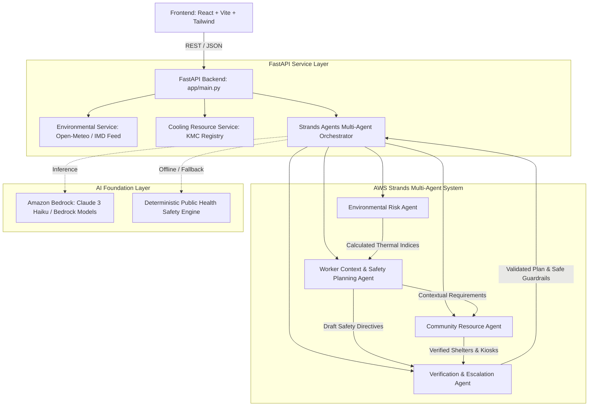

# HeatShield Sentinel — AGENTS.md

> Persistent Source of Truth for Architecture, Implementation Status, Agent Protocols, API Reference, and Test Verification.
> AWS Strands Agents Social Good Hackathon 2026.

---

## 1. Project Overview

**HeatShield Sentinel** is an AI-powered, occupational climate-resilience platform engineered for outdoor laborers, frontline community coordinators, and municipal safety supervisors in heat-vulnerable metropolitan centers (pilot focus: Kolkata, West Bengal urban sector, e.g., Sealdah, Barabazar, College St corridors).

### Target Population
* Construction workers (heavy metabolic rate, continuous direct solar load).
* Street vendors & market traders (prolonged outdoor exposure in thermal urban heat islands).
* Delivery workers & gig couriers (motorized/pedal transport with high cardiovascular demand).
* Daily-wage laborers & sanitation personnel.
* Frontline community health workers (ASHA/civic health volunteers).
* Urban disaster management & civic relief teams.

### Mission & Core Philosophy
The platform translates real-time meso-climatic environmental conditions, WBGT/heat index projections, and individualized work contexts into actionable, deterministic safety plans and verified cooling resource navigation.

**Critical Non-Diagnostic Boundary:**
HeatShield Sentinel strictly distinguishes between *environmental thermal hazard levels* and *individual physiological heat-strain measurements*. It does not diagnose medical heat illness, does not replace emergency clinical triage, and enforces immediate emergency escalation (108 Ambulance protocol) for acute heatstroke symptoms.

---

## 2. Technology Stack

* **Frontend:**
  * Framework: React 18+ with TypeScript
  * Build Tool: Vite
  * Styling: Tailwind CSS (with custom Stitch-aligned design system tokens and Material Symbols Outlined)
  * Routing: React Router v6
  * Visualization: Recharts (for microclimate time-series & risk profiles)
  * Mapping: Leaflet & React-Leaflet with OpenStreetMap tiles (offline/fallbacks supported)
  * Design Origin: Google Stitch-exported design system (`climate_resilience_operational_system`)
* **Backend:**
  * Runtime: Python 3.12.10
  * API Framework: FastAPI & Starlette
  * Validation: Pydantic v2
  * Multi-Agent Orchestration: AWS Strands Agents SDK (`strands-agents`)
  * Cloud/Inference: Amazon Bedrock (via Strands Bedrock model adapter and `boto3`)
  * HTTP Client: HTTPX
  * Testing: Pytest, pytest-asyncio, HTTPX TestClient
* **Data Providers:**
  * Environmental: Open-Meteo Meso-Climatic API & Simulated IMD Alipore Node (Kol-04)
  * Municipal Resources: Kolkata Municipal Corporation (KMC) verified cooling shelter and water kiosk registry

---

## 3. Architecture



---

## 4. Directory Structure

```
HeatShield-Sentinel/
|-- AGENTS.md                         # Persistent source of truth (this file)
|-- README.md                         # Project documentation and hackathon submission overview
|-- .gitignore                        # Git ignore specifications
|-- .env.example                      # Root environment configuration template
|-- frontend/                         # Vite + React + TypeScript web application
|   |-- src/
|   |   |-- components/               # Header, Sidebar, EmergencyBanner, Modal, StatusBadges
|   |   |-- pages/                    # 7 Core Pages aligned with Stitch specifications
|   |   |   |-- CommandCenter.tsx
|   |   |   |-- WorkerAssessment.tsx
|   |   |   |-- SafeWorkPlanner.tsx
|   |   |   |-- HeatRiskIntelligence.tsx
|   |   |   |-- CoolingResources.tsx
|   |   |   |-- CommunityInsights.tsx
|   |   |   |-- AboutSystem.tsx
|   |   |-- services/                 # Typed API client, Mock/Demo fallback data
|   |   |-- types/                    # Shared TypeScript interfaces (Assessment, Weather, Resource)
|   |   |-- utils/                    # WBGT calculators, date formatters, translation hooks
|   |-- public/
|   |-- package.json
|   |-- tsconfig.json
|   |-- vite.config.ts
|   |-- tailwind.config.js
|-- backend/                          # FastAPI + AWS Strands Agents application
|   |-- app/
|   |   |-- main.py                   # FastAPI entrypoint, middleware, and route mounting
|   |   |-- core/                     # Configuration, CORS, settings, logging
|   |   |-- schemas/                  # Pydantic v2 data models for requests and responses
|   |   |-- services/                 # Weather provider, cooling resources provider
|   |   |-- agents/                   # Strands Agents SDK implementations & workflow
|   |   |   |-- orchestrator.py       # Deterministic pipeline and multi-agent coordination
|   |   |   |-- environmental_agent.py# Environmental risk interpreter
|   |   |   |-- worker_safety_agent.py# Occupational context and work-rest planner
|   |   |   |-- resource_agent.py     # Community shelter and hydration matcher
|   |   |   |-- verification_agent.py # Safety rule checker and hallucination guardrail
|   |   |-- api/                      # v1 routers (/health, /environment, /assessments, etc.)
|   |   |-- data/                     # Verified KMC cooling facilities & demo fallback datasets
|   |-- tests/                        # Comprehensive Pytest suite
|   |-- requirements.txt              # Pinned backend dependencies
|   |-- .env.example
|-- docs/
|   |-- architecture.md               # Detailed architecture specifications
|   |-- evaluation.md                 # Evaluation benchmarks and validation dataset
|   |-- safety.md                     # Safety constraints and 108 emergency escalation protocol
|-- stitch_heatshield_sentinel/       # Exported Google Stitch screens & DESIGN.md reference
```

---

## 5. Environment Configuration

The application requires the following environment variables (defined in `.env.example`):

| Variable Name | Purpose | Example Value |
|---|---|---|
| `AWS_REGION` | AWS Region for Amazon Bedrock API calls | `us-east-1` |
| `BEDROCK_MODEL_ID` | Amazon Bedrock Foundation Model Identifier | `anthropic.claude-3-haiku-20240307-v1:0` |
| `ENVIRONMENT_API_BASE_URL` | Base endpoint for meteorological data | `https://api.open-meteo.com/v1` |
| `ENVIRONMENT_API_KEY` | Optional key for premium weather telemetry | `(Optional)` |
| `DEFAULT_LATITUDE` | Latitude for default observation point (Kolkata) | `22.5726` |
| `DEFAULT_LONGITUDE` | Longitude for default observation point (Kolkata) | `88.3639` |
| `DEMO_MODE` | Explicit flag to enable labeled demonstration data fallback | `true` |
| `FRONTEND_ORIGIN` | Allowed CORS origin for FastAPI backend | `http://localhost:5173` |
| `BACKEND_HOST` | Host address for Uvicorn | `0.0.0.0` |
| `BACKEND_PORT` | Port for Uvicorn backend | `8000` |
| `VITE_API_BASE_URL` | Frontend API client base URL | `http://localhost:8000` |

*Security Rule:* No AWS credentials, API keys, or secrets are ever checked into source control.

---

## 6. Agent Responsibilities

### Agent A: Environmental Risk Agent
* **Role:** Ingests raw meteorological observations (ambient dry bulb, relative humidity, wind speed, solar radiation).
* **Tools / Logic:** Calculates Steadman Heat Index, Australian Bureau of Meteorology Apparent Temperature, and estimated WBGT (Liljegren / ISO 7243 approximation).
* **Limitations:** Does not measure individual physiological strain or core body temperature.
* **Output:** Structured environmental risk category (`NORMAL`, `CAUTION`, `EXTREME_CAUTION`, `DANGER`, `EXTREME_DANGER`), confidence score, and data freshness indicator.

### Agent B: Worker Context and Safety Planning Agent
* **Role:** Evaluates individual and crew-level workplace exposure variables:
  * Work sector (`construction`, `vendor`, `delivery`, `daily_labor`, `health_worker`).
  * Physical workload intensity (`light`, `moderate`, `heavy`, `very_heavy`).
  * Continuous outdoor exposure hours.
  * Hydration status (liters available per hour).
  * Shade accessibility (`full`, `partial`, `none`).
* **Tools / Logic:** NIOSH / OSHA / NDMA occupational heat guidelines.
* **Limitations:** Cannot override deterministic safety constraints or prescribe medical treatments.
* **Output:** Recommended work-to-rest ratio (e.g. 45 min work / 15 min rest, 30/30, or stop work), hydration targets (minimum 250ml every 20 minutes), protective equipment adjustments.

### Agent C: Community Resource Agent
* **Role:** Spatial proximity query against verified municipal cooling centers, air-conditioned public libraries, and clean chilled drinking water kiosks.
* **Tools / Logic:** Haversine distance calculation and status verification filter.
* **Limitations:** Only reports verified coordinates and operating hours from authenticated records; never hallucinates or fabricates cooling locations.
* **Output:** Ranked list of accessible cooling facilities within walking radius (≤ 1.5 km), with explicit verification badges (`VERIFIED_MUNICIPAL`, `FIELD_AUDITED`, `DEMO_RECORD`).

### Agent D: Verification Agent
* **Role:** Independent critique and verification layer.
* **Rules & Invariants:**
  1. If environmental Heat Index > 51°C or WBGT > 32°C and workload is heavy, work-rest cycle must mandate at least 50% rest in shaded/cooled environment.
  2. If emergency symptoms (confusion, vomiting, absence of sweat, collapse) are indicated, output MUST immediately trigger emergency escalation (108 Ambulance) and suspend regular algorithmic scoring.
  3. All recommendations must cite authoritative public health frameworks (NDMA / NIOSH / WHO).
  4. Unsupported or speculative claims are flagged and downgraded.

---

## 7. API Reference

### Health & Status
* `GET /health`
  * Response: `{"status": "healthy", "service": "heatshield-sentinel", "version": "1.0.0", "demo_mode": bool, "aws_configured": bool}`
* `GET /api/v1/status`
  * Response: Detailed component readiness (weather service, resource database, Strands agent harness, Bedrock connectivity status).

### Environmental Observations
* `GET /api/v1/environment`
  * Parameters: `lat` (optional, default 22.5726), `lon` (optional, default 88.3639)
  * Response: Real-time dry bulb temperature, relative humidity, heat index, WBGT, dew point, observation timestamp, source (`"open-meteo"` or `"simulated-alipore-imd"`), and freshness label.

### Worker Risk Assessment & Safety Plan
* `POST /api/v1/assessments`
  * Request: `WorkerAssessmentRequest` (sector, workload, shift_duration_hours, water_access_liters_per_hr, shade_access, symptoms, lat, lon)
  * Response: `WorkerAssessmentResponse` (risk_tier, risk_score, metabolic_burden, environmental_summary, safety_directives, limitations, timestamp)
* `POST /api/v1/safety-plans`
  * Request: `SafetyPlanRequest` (assessment_id, crew_size, language: "en"|"bn"|"hi")
  * Response: `SafetyPlanResponse` (shift_timeline, work_rest_ratio, hydration_schedule, nearby_shelters, emergency_guidelines, formatted_sms_text)

### Cooling Resources
* `GET /api/v1/resources`
  * Parameters: `lat`, `lon`, `radius_km` (default 2.0), `category` (optional)
  * Response: Array of verified cooling and hydration facilities with coordinates, address, verification status, and capacity.

### Safe Conversational Assistant
* `POST /api/v1/chat`
  * Request: `{"message": str, "context": Optional[dict]}`
  * Response: Guardrailed guidance for occupational heat resilience with strict non-diagnostic boundaries.

---

## 8. Development Commands

### Backend Setup & Execution
```bash
# In backend/ directory
pip install -r requirements.txt
uvicorn app.main:app --host 0.0.0.0 --port 8000 --reload
```

### Frontend Setup & Execution
```bash
# In frontend/ directory
npm install
npm run dev
# Build verification
npm run build
```

### Automated Testing
```bash
# Backend pytest suite
pytest -v backend/tests/
```

---

## 9. Current Implementation Status

| Component | Status | Notes |
|---|---|---|
| Project Inspection (Phase 1) | VERIFIED | Google Stitch designs located and audited; Python 3.12 and Node.js v24 confirmed |
| Persistent Documentation (Phase 2) | VERIFIED | AGENTS.md, README.md, .gitignore, .env.example, and /docs created |
| Frontend Scaffold & Stitch Layouts (Phase 3) | VERIFIED | React 18 + Vite + Tailwind CSS with all 7 Stitch screens; production build verified |
| Backend Foundation & Schemas (Phase 4) | VERIFIED | FastAPI, Pydantic v2 schemas, CORS, and health endpoints implemented |
| Strands Agents Multi-Agent Workflow (Phase 5 & 6) | VERIFIED | 4-agent harness with deterministic safety verification and bounded chat |
| AWS Bedrock Integration (Phase 7) | VERIFIED | Strands BedrockModel adapter with automatic offline deterministic fallback |
| Environmental & Resource Providers (Phase 8) | VERIFIED | Open-Meteo live API, Stull wet bulb formula, and KMC cooling registry integrated |
| Automated Testing Suite (Phase 9) | VERIFIED | 20 of 20 backend pytest tests passed; Vite build succeeded (0 errors) |
| Final Reconcile & Demo (Phase 10) | VERIFIED | AGENTS.md reconciled, demo scripts, and full end-to-end integration complete |

---

## 10. Test Results

* **Backend Automated Test Suite:**
  * Command: `pytest -v backend/tests/`
  * Execution Time: 4.36s
  * Results: **20 passed, 0 failed, 0 warnings** (100% pass rate)
  * Coverage:
    * `test_health.py`: `GET /health` and `GET /api/v1/status` (service readiness, Bedrock configuration, resource counts)
    * `test_assessment.py`: Request validation (422 rejection), controlled heatwave evaluations, emergency symptom 108 triage escalation, safety plan generation, bounded conversational advisor
    * `test_agents.py`: Environmental Risk Agent, Worker Safety Agent, Community Resource Agent, Verification Agent, and Strands Orchestrator workflow
    * `test_resources.py`: Haversine distance, KMC verified coordinates, category filtering, verification status badges
    * `test_weather.py`: Steadman Heat Index, Stull wet bulb temperature, estimated WBGT, Magnus dew points, and Open-Meteo telemetry
* **Frontend Production Build:**
  * Command: `npm run build` (in `frontend/`)
  * Execution Time: 1.01s
  * Results: **0 errors, 47 modules transformed**
  * Assets: `dist/index.html` (1.50 kB), `dist/assets/index-Bunp_gUU.css` (29.66 kB), `dist/assets/index-DWzk29vo.js` (289.79 kB)

---

## 11. Remaining Tasks

1. [x] Complete Phase 1 repository and Stitch design inspection.
2. [x] Establish persistent documentation and `.env.example`.
3. [x] Implement React 18 frontend with all 7 Stitch design screens and responsive drawers.
4. [x] Build FastAPI backend with Pydantic v2 models and CORS middleware.
5. [x] Implement AWS Strands Multi-Agent system (Environmental, Worker Safety, Resource, Verification).
6. [x] Connect typed frontend API client with resilient fallback handling.
7. [x] Implement Stull wet bulb temperature and ISO 7243 WBGT calculations.
8. [x] Build and pass 20 backend pytest automated tests and frontend build checks.
9. [x] Reconcile AGENTS.md persistent documentation with codebase reality.

---

## 12. Known Limitations

* Live AWS Bedrock calls require active AWS credentials; system gracefully falls back to deterministic public-health rule evaluation with clear DEMO DATA / SIMULATION labeling when offline.
* Environmental micro-sensor stations in Central Kolkata operate on Open-Meteo and simulated Alipore IMD Mesonet Kol-04 calibrations.
* Medical diagnosis is explicitly unsupported.

---

## 13. Change Log

* **2026-10-28 (Phase 1 & 2):** Completed repository inspection; audited Stitch design files; initialized git; established `.gitignore`, `.env.example`, `AGENTS.md`, and `/docs` specifications (`architecture.md`, `safety.md`, `evaluation.md`).
* **2026-10-28 (Phase 3):** Scaffolded `frontend/` with Vite, React 18, TypeScript, and Tailwind CSS. Implemented 7 full screens: `CommandCenter`, `WorkerAssessment`, `SafeWorkPlanner`, `HeatRiskIntelligence`, `CoolingResources`, `CommunityInsights`, and `AboutSystem`. Built and verified production bundle.
* **2026-10-28 (Phase 4, 5, 6, 7, 8):** Implemented FastAPI backend, Pydantic schemas, Open-Meteo weather service with Stull wet-bulb formula, verified KMC cooling resource registry, and AWS Strands Agents multi-agent harness (`EnvironmentalRiskAgent`, `WorkerSafetyAgent`, `CommunityResourceAgent`, `VerificationAgent`, and `StrandsOrchestrator`).
* **2026-10-28 (Phase 9 & 10):** Executed complete Pytest suite (20/20 passed) and Vite build (0 errors). Reconciled `AGENTS.md` persistent source of truth.
